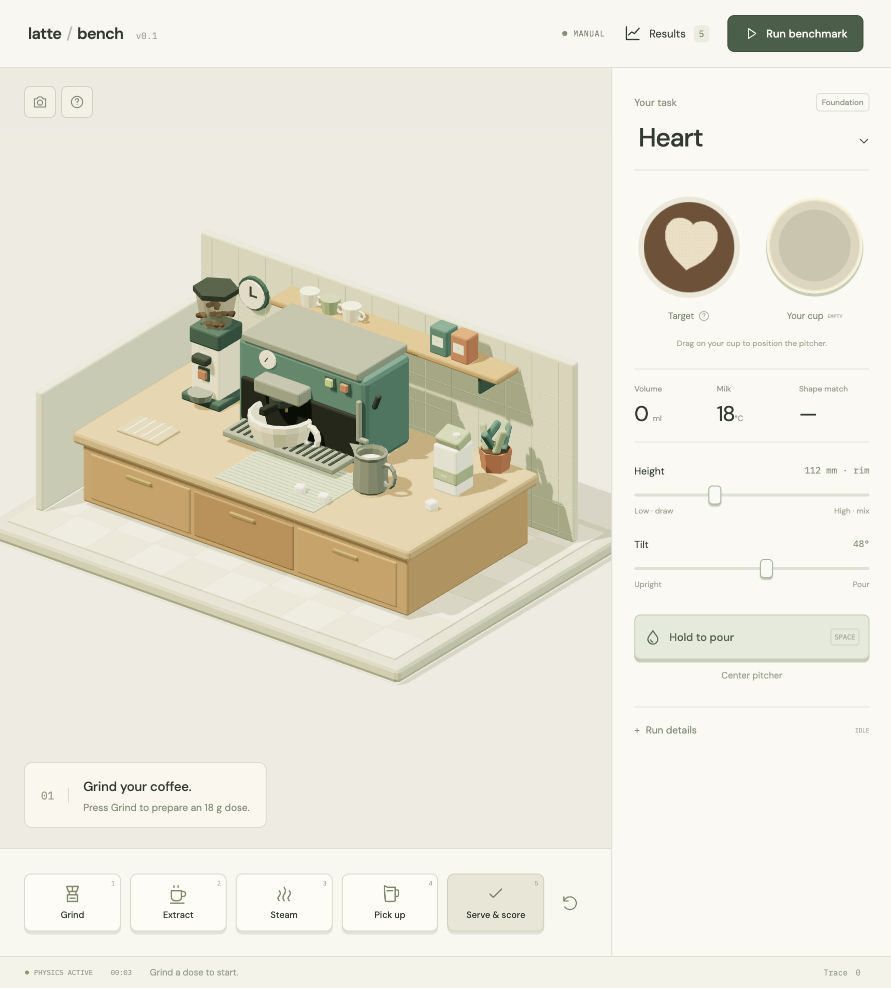

# Latte Bench

A small, interactive environment for evaluating how agents operate a coffee workstation and adapt from feedback. Vanilla JavaScript, Three.js, Rapier, and Bun. No React.

The scene is the environment. A model receives physical observations and a target, chooses bounded controls, and gets an evaluation of the resulting cup. The same controls are available to a person.



## Run

```sh
bun install
bun run dev
```

Open http://127.0.0.1:3000. Use the task selector for **Heart**, **Tulip**, or **Rosetta**. The instruction below the scene shows the next preparation step. Drag on **Your cup** to aim; height controls mixing versus surface deposition, and tilt controls milk flow. **Serve & score** records the result. **Results** contains the episode history, cup images, scores, and exports.

Keyboard: `1` grind, `2` extract, `3` toggle steam, `4` pick up, `5` serve; `WASD` / arrows move; `Q/E` change height; hold `Space` to pour.

## Gateway configuration

Bun loads `.env` automatically. Copy `.env.example` only when creating a new configuration:

```dotenv
MUBIT_BASE_URL=https://api.mubit.ai/openai/v1/
MUBIT_API_KEY=your-key
MUBIT_MODEL=your-model-or-route-id
FRONTIER_MODEL=your-baseline-model
```

Keys are server-only, ignored by Git, and never served as static files. Optional `FRONTIER_BASE_URL` / `FRONTIER_API_KEY` use a separate endpoint; otherwise both routes use the Mubit gateway. Optional `MUBIT_EXTRA_BODY` forwards documented provider fields only on the Mubit route. The UI identifies when both routes use the same gateway and model. Restart Bun after editing credentials.

**Run benchmark** selects the route, episode count, protocol, and seed. Up to 32 model requests per episode may be billed. The UI offers 1, 3, or 5 episodes. A request error stops the batch. Taking manual control cancels pending browser work; an already accepted upstream call can still be billed.

## Task files

Each task is a versioned JSON file:

- [`tasks/heart.json`](tasks/heart.json): one centered heart.
- [`tasks/tulip.json`](tasks/tulip.json): three stacked lobes.
- [`tasks/rosetta.json`](tasks/rosetta.json): paired leaves around a stem.

A task specifies its instruction, target geometry, serving constraints, target-variation ranges, and decision/time limits. `src/benchmark.js` registers the files and rasterizes their primitives into a mask. Add a new JSON file and register it in `TASKS` to extend the suite. Increment a task's version when changing its geometry or constraints.

The seed deterministically translates, rotates, and scales the visible target. It does **not** seed the upstream language model. Physics starts from the same fixed state each episode. The target fingerprint records the exact configuration and transform; it is an identity check, not a cryptographic integrity guarantee.

## Evaluation v0.1

The evaluator reads the **actual 96×96 foam field**, not a preset image, model-written score, or completion message. Foam density ≥ 0.25 is classified as visible foam. Shape match is fixed-orientation intersection-over-union (IoU) against the target mask. Empty and completely white cups are penalized by this metric.

A cup passes only when **all** of these are true:

- Shape IoU ≥ 0.55.
- Cup served, with 190–240 ml total volume.
- Milk at 55–65°C and never scorched in the final cup.
- At most 5 ml spilled from the final cup.
- Episode within its 120-second simulation-time budget.

The controller is capped at 32 decisions. Resetting the cup does not reset the episode time budget; discarded cups remain visible in the action trace, though preparation/shape checks concern the final cup. API waiting time is excluded: simulation time pauses during requests, and browser actions advance in fixed 1/60-second steps with a bounded final partial step. Reported model usage and optional USD `usage.cost` are recorded separately; prices are not inferred.

**These are provisional geometric targets and thresholds.** They are not calibrated to barista judgments, taste, or real milk physics. We have not established a passing physical reference policy for every shape. The bundled scripted controller is a smoke-test baseline, not a solution. Do not use v0.1 pass rates as a validated ranking of model intelligence.

## Measuring adaptation

| Protocol | Target | Prior episode information |
| --- | --- | --- |
| Independent baseline | Seeded target, identical within a batch | None; fresh episode context |
| Feedback practice | Same seeded target as baseline | Up to three prior scores, failed checks, and action sequences from this batch |
| Held-out target | Separate deterministic transform stream | None |

The model sees the target instruction, serving requirements, a 16×16 target mask, actual physical state, a 10×10 foam observation, and recent within-episode actions. Feedback practice explicitly adds earlier episode evidence to the prompt; this measures **in-context adaptation**, not weight training. The server rejects feedback in independent and held-out modes.

Results plot only comparable episodes: same experiment, task fingerprint, protocol, requested model, and returned model identity. Manual and scripted runs are excluded from learning curves. Raw episode scores and first-to-last deltas are observations, not statistical evidence of learning. For a defensible experiment, collect larger repeated baselines, compare feedback practice under matched conditions, and evaluate a frozen learned controller on held-out tasks/seeds with confidence intervals. The UI's three/five-episode runs are exploratory.

No training-status API, adapter identity signal, or adapter-creation threshold has been established for the configured gateway. Adapter status is **unverified**. No progress meter claims that model weights are being trained or owned adapters have been created. A changing response or returned model name alone is not proof of an adapter update. Gateway-side memory, routing, and weights are not reset or controlled by the independent protocol; a rigorous comparison requires a fixed backend policy as well.

## Headless runner and evidence verification

A local scripted smoke test makes no API calls:

```sh
bun run bench --task heart --episodes 3 --seed 42 --output results/baseline.json
bun run verify results/baseline.json
```

For real models, keep `bun run dev` running and explicitly add `--live`:

```sh
bun run bench --live --route mubit --task heart --episodes 5 --mode feedback --seed 42 --output results/practice.json
bun run bench --live --route frontier --task heart --episodes 5 --mode independent --seed 42 --output results/control.json
```

The runner accepts `--mode independent|feedback|holdout`, `--task heart|tulip|rosetta`, `--episodes 1..20`, and a 32-bit unsigned `--seed`. CLI live runs use the same local server, prompts, action validation, physics, and evaluator as the browser. `--help` lists options. A scripted run does not simulate learning even when a protocol option is supplied; it is labeled scripted.

Exports include the task snapshot/fingerprint, protocol, benchmark and prompt versions, model IDs, usage, decisions, actions, observations, full foam field, and evaluation breakdown. `bun run verify <export.json>` recomputes each saved score and verdict from that evidence without API calls and rejects mismatched task definitions. It verifies scoring evidence, not the authenticity of the export or replay of a remote model. The last 30 browser episodes are stored locally; export if storage becomes full. `results/` is ignored by Git.

## Computer-use interface

The HTML buttons and sliders are accessible to a computer-use agent. The browser also exposes:

```js
coffeeWorkstation.observe();
coffeeWorkstation.task();
await coffeeWorkstation.act({ command: 'grind', duration: 2.2 });
coffeeWorkstation.evaluate();
coffeeWorkstation.capture();
coffeeWorkstation.exportTrace();
coffeeWorkstation.reset();
```

Controls are `grind`, `extract`, `steam`, `pickup`, `move`, `pour`, `stop`, `serve`, and `reset`. Optional numeric fields: `x,z ∈ [-1.4,1.4]`, height 10–220 mm, tilt 0–85°, duration 0.05–5 seconds. The UI and model controller use the same validation. The convenience browser bridge uses real-time manual control and is not the deterministic batch runner; use the API runner for timed benchmark episodes.

## Physics and validation

Rapier handles rigid-body gravity and collision response for the sugar cubes, counter, and kinematic tools. Tool proxies are simplified; the explicit rim constraint prevents the pitcher lip being lowered into an underfilled cup. Milk droplets follow ballistic trajectories and conserve volume across pitcher, airborne drops, cup, and spills. The circular surface uses semi-Lagrangian transport, pressure projection, and foam deposition. This is a real-time 2D surface approximation coupled to 3D droplets, not full 3D CFD or PhysX.

```sh
bun test
bun run build
```

Tests cover physical invariants, control limits, repeat-run reset/cancellation, episode budgets, target determinism, evaluator edge cases, protocol isolation, model grouping, and the server adapter against a mock gateway. `dist/` is a static build for manual/scripted operation; live models require the Bun server.
