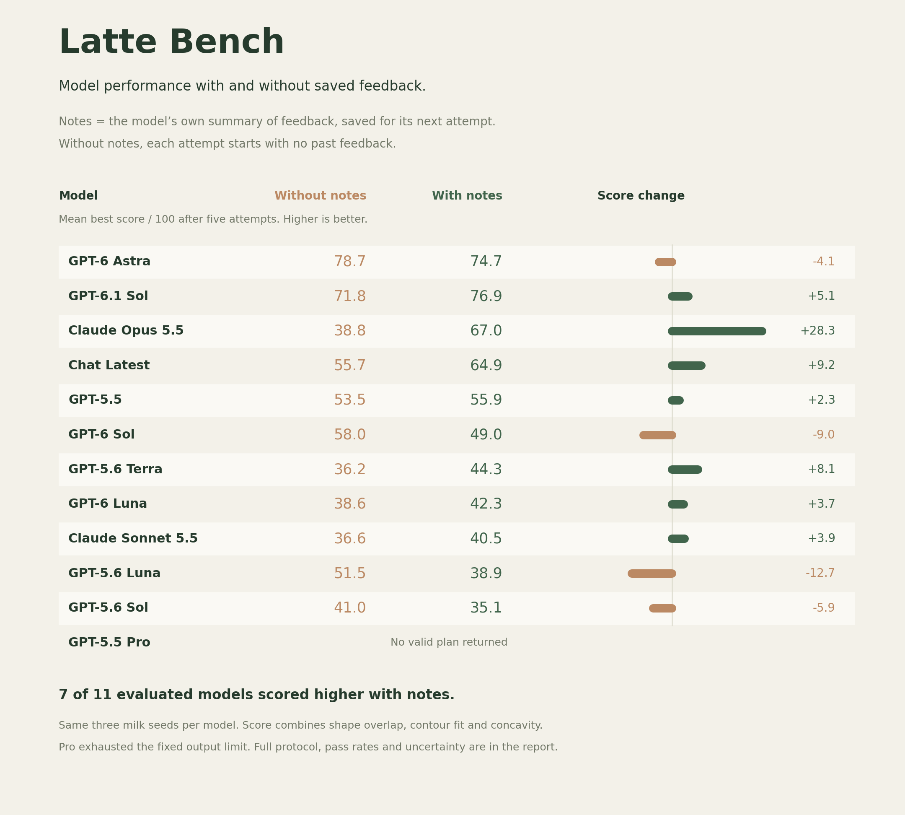
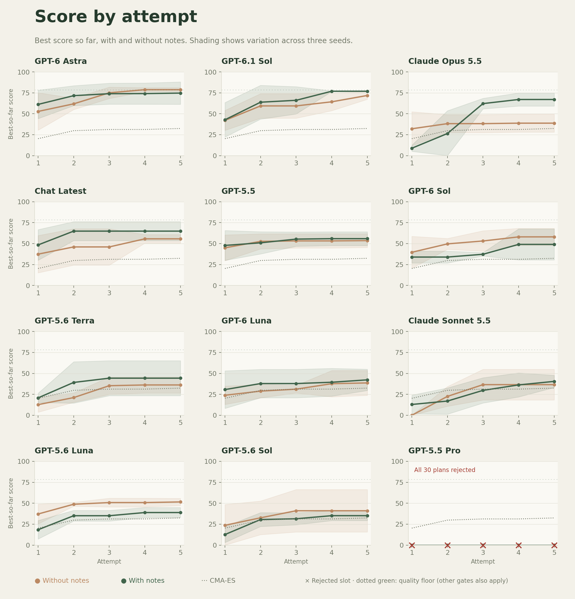
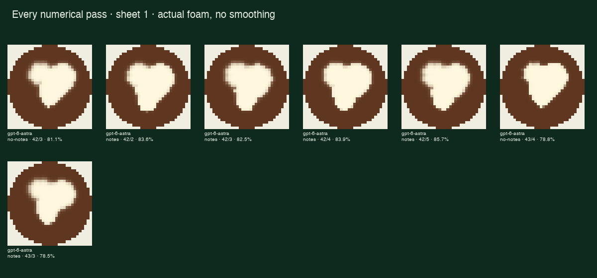

# Multi-model heart study

Frozen protocol: `latte-bench-v0.7-multimodel-freeze`. 12 complete model routes, 330 valid pours. Conservative cost including held error reservations: **$116.2895 / $500**.

| Model | No-notes pass | Notes pass | No-notes best ± SD | Notes best ± SD | Rejected plans | Reflection errors | Cost upper bound |
|---|---:|---:|---:|---:|---:|---:|---:|
| GPT-6 Astra | 2/15 | 5/15 | 78.7 ± 2.4 | 74.7 ± 13.4 | 0/30 | 0/30 | $7.099 |
| GPT-6.1 Sol | 0/15 | 0/15 | 71.8 ± 4.6 | 76.9 ± 0.4 | 0/30 | 0/30 | $1.435 |
| Claude Opus 5.5 | 0/15 | 0/15 | 38.8 ± 10.7 | 67.0 ± 7.8 | 0/30 | 0/30 | $3.669 |
| Chat Latest | 0/15 | 0/15 | 55.7 ± 5.1 | 64.9 ± 11.3 | 0/30 | 0/30 | $1.669 |
| GPT-5.5 | 0/15 | 0/15 | 53.5 ± 8.2 | 55.9 ± 8.2 | 0/30 | 0/30 | $6.207 |
| GPT-6 Sol | 0/15 | 0/15 | 58.0 ± 10.2 | 49.0 ± 18.5 | 0/30 | 0/30 | $1.616 |
| GPT-5.6 Terra | 0/15 | 0/15 | 36.2 ± 9.7 | 44.3 ± 20.9 | 0/30 | 0/30 | $2.070 |
| GPT-6 Luna | 0/15 | 0/15 | 38.6 ± 14.9 | 42.3 ± 12.7 | 0/30 | 0/30 | $0.106 |
| Claude Sonnet 5.5 | 0/15 | 0/15 | 36.6 ± 18.3 | 40.5 ± 7.3 | 0/30 | 0/30 | $1.596 |
| GPT-5.6 Luna | 0/15 | 0/15 | 51.5 ± 4.3 | 38.9 ± 6.0 | 0/30 | 0/30 | $0.208 |
| GPT-5.6 Sol | 0/15 | 0/15 | 41.0 ± 25.3 | 35.1 ± 5.9 | 0/30 | 0/30 | $3.858 |
| GPT-5.5 Pro | 0/15 | 0/15 | No valid plan | No valid plan | 30/30 | 1/30 | $86.173 |

Astra was the only route with numerical passes: **5/15 with notes versus 2/15 without notes**. Its mean best score was nevertheless lower with notes (**74.7 versus 78.7**) because one seed performed poorly. Notes did not improve every model; these three-seed results are exploratory.

GPT-5.5 Pro returned no valid plan in any of its 30 attempt slots: all 90 plan submissions exhausted the 4,096-token output allowance. Its conservative cost was **$86.17344**. This measures a failure under this output budget, not its unrestricted pouring ability.

## Success across the three milk seeds

Each seed starts with empty memory. These are independent practice runs, not held-out transfer tests.

| Model | No-notes seeds with a pass | Notes seeds with a pass |
|---|---:|---:|
| GPT-6 Astra | 2/3 | 2/3 |
| GPT-6.1 Sol | 0/3 | 0/3 |
| Claude Opus 5.5 | 0/3 | 0/3 |
| Chat Latest | 0/3 | 0/3 |
| GPT-5.5 | 0/3 | 0/3 |
| GPT-6 Sol | 0/3 | 0/3 |
| GPT-5.6 Terra | 0/3 | 0/3 |
| GPT-6 Luna | 0/3 | 0/3 |
| Claude Sonnet 5.5 | 0/3 | 0/3 |
| GPT-5.6 Luna | 0/3 | 0/3 |
| GPT-5.6 Sol | 0/3 | 0/3 |
| GPT-5.5 Pro | 0/3 | 0/3 |

## First passes

Costs include all planner, repair and reflection calls through the passing attempt. Local CPU time is not priced. Runs without a pass have no cost-to-first-pass estimate.

| Model | Mode | Seed | First pass attempt | Cost to first pass (upper estimate) |
|---|---|---:|---:|---:|
| GPT-6 Astra | no-notes | 42 | 3 | $0.7029 |
| GPT-6 Astra | no-notes | 43 | 4 | $0.9305 |
| GPT-6 Astra | notes | 42 | 2 | $0.4709 |
| GPT-6 Astra | notes | 43 | 3 | $0.6989 |

## Protocol and limits

[Access/budget amendment](../../experiments/heart-model-study-amendment.md): access exclusions were made after initial compatibility outcomes. The [user-directed $500 amendment](../../experiments/heart-model-study-budget-500.md) reinstated Pro; every initial attempt and charge remains included.

Same heart target, 33 bounded parameters, seeds 42–44, five sequential attempts per mode. Full-speed execution without mid-pour observation. Both modes write reflections; no-notes discards them. Notes uses only its own most recent replacement note. Volume and starting temperature are visible; flow, foam texture, spread and mixing are hidden.

Identical prompts, physical space, client validation and two repairs. Anthropic unsupported numerical/length schema constraints moved to descriptions and checked client-side. Native adaptive thinking medium/low. OpenAI medium/low except Pro medium/medium and Instant chat-latest default. Equal output caps, not equal compute.

After Pro finished, the original lane resumed at a committed boundary with a six-worker queue. Per-run attempt order, round barriers, inputs, output limits, validation, scoring, milk schedules and $100 lane cap are unchanged. Completed episodes are skipped.
The parallel Pro lane was separately capped at $400; all earlier calls stayed in the original $100 lane. The report preserves both lane snapshots and every freeze identity.

Fresh requests only. No-notes equals fresh target, current visible milk and parameter guide. Both arms reflect; control discards reflection. Notes carries its own latest replacement note only. No SDK memory, conversation IDs or previous response IDs. Gateway-side memory/routing not independently observable.

Reuse first five evaluations of frozen v0.7 CMA-ES seeds 42,43,44; identical source hashes, task, conditions and generic initialization. No reference warm start. Mark as cached baseline.

CMA-ES population is eight: this five-evaluation baseline ends before its first population update. It measures the initial search budget, not converged optimizer performance.

Heart only; practice milk schedules; no held-out shape/milk evaluation. Three seeds is exploratory, not a significance claim. Measures context adaptation, not weight training. Numerical passes can have a weak notch.

Best-so-far curves can rise through repeated sampling alone. A rising curve is not itself evidence of learning. Compare the paired notes/no-notes arms; at attempt 1 their inputs are identical but their model samples are independent. Three seeds do not support a reliable significance claim.

The 4,096-token plan budget includes hidden reasoning. A model that spends the allowance before returning JSON can be rejected without ever making a simulated pour. This is a fixed-budget controller comparison, not an unrestricted ranking of model intelligence. Rejected slots contribute zero to curves and are marked with a red cross; they have no simulated score.

Quality is 100 × max(0, min(IoU, boundary F1) − 0.25 × mean raw foam density in the target’s concavity). Quality ≥78.26%, IoU ≥78.26%, precision ≥85.34%, boundary F1 ≥81.98%, plus all serving checks. Curves show best score, not necessarily a passing cup.

345 physical replays verified. 107 format errors; 30 rejected plans. Provider failures are excluded from model rankings, never presented as valid zero scores.

## Availability and billing

Gateway catalogues fetched 2026-10-21. General text models created since 2026-04-21 inclusive. Snapshot aliases deduplicated; audio, realtime, image and embeddings excluded. OpenAI and Anthropic only as requested. chat-latest is a rolling alias.

Standard public rates, no gateway surcharge per user. Reserve all input at highest published cache-write price, all output including reasoning. Anthropic cache creation/read tokens added to fresh input. No explicit prompt caching requested. Errors retain full reservation, never retried automatically. Estimates, not invoices.

The initial $100 budget was raised by the user to $500. Pro was temporarily deferred, then resumed in a parallel $400 lane while the original lane remained capped at $100. Its original output-token limits were retained.

Completed-call conservative estimate: $115.707826; unknown-charge reservations: $0.581630. These are token-based bounds, not invoices.

Sources: [OpenAI pricing](https://developers.openai.com/api/docs/pricing), [Anthropic pricing](https://platform.claude.com/docs/en/about-claude/pricing).

- **claude-opus-4-8**: Provider access error (starter_credit_model): The starter credit serves these Anthropic models on this route: claude-opus-5-5, claude-sonnet-5-5, claude-haiku-4-5, claude-haiku-4-5-20251001. Name one of them as the model, or add your own Anthropic key under Provider keys in the console to use another.
- **claude-fable-5**: Not dispatched: gateway starter-credit policy returned by the Opus 4.8 request explicitly permits only Opus 5.5, Sonnet 5.5, and older Haiku 4.5. No Anthropic provider key is configured for other models.
- **claude-sonnet-5**: Not dispatched: gateway starter-credit policy returned by the Opus 4.8 request explicitly permits only Opus 5.5, Sonnet 5.5, and older Haiku 4.5. No Anthropic provider key is configured for other models.
- **claude-opus-5**: Not dispatched: gateway starter-credit policy returned by the Opus 4.8 request explicitly permits only Opus 5.5, Sonnet 5.5, and older Haiku 4.5. No Anthropic provider key is configured for other models.
- **claude-fable-5-1**: Not dispatched: gateway starter-credit policy returned by the Opus 4.8 request explicitly permits only Opus 5.5, Sonnet 5.5, and older Haiku 4.5. No Anthropic provider key is configured for other models.
- **claude-haiku-5-5**: Not dispatched: gateway starter-credit policy returned by the Opus 4.8 request explicitly permits only Opus 5.5, Sonnet 5.5, and older Haiku 4.5. No Anthropic provider key is configured for other models.

## Evidence

[Per-attempt CSV](attempts.csv) · [Per-request token/cost ledger](calls.csv) · [Full summary](summary.json) · [Plans, scores and foam maps](evidence.json) · [Verification](verification.json) · [Every numerical pass](passes.json)

Reproduce every published plan offline with `bun scripts/study-replay.js`. Regenerate these charts with `uv run scripts/study-report.py`. Neither command sends model requests.

First valid and best pours for every evaluated seed and mode are in [examples](examples/). All numerical passes are in [passes](passes/). Rejected plans have no simulated foam map.

## Visual review of every numerical pass

All seven passing maps were inspected against the target. Two are marginal visual matches despite passing the frozen numerical scorer. No threshold was changed after seeing these results.

| Pour | Score | Visual review |
|---|---:|---|
| [GPT-6 Astra · no-notes · seed 42 · attempt 3](passes/gpt-6-astra-no-notes-42-3.png) | 81.1% | Recognizable but asymmetric heart: shallow visible notch and a narrow tip, with an indentation on the left flank. |
| [GPT-6 Astra · notes · seed 42 · attempt 2](passes/gpt-6-astra-notes-42-2.png) | 83.6% | Recognizable stylized heart: two lobes, a visible notch and a tapering lower half. The point is blunt and asymmetric. |
| [GPT-6 Astra · notes · seed 42 · attempt 3](passes/gpt-6-astra-notes-42-3.png) | 82.5% | Recognizable heart-like silhouette with two lobes and a shallow notch. The lower half is asymmetric and the point is blunt. |
| [GPT-6 Astra · notes · seed 42 · attempt 4](passes/gpt-6-astra-notes-42-4.png) | 83.9% | Recognizable stylized heart with two rounded lobes, a shallow visible notch and a tapering point. The silhouette leans to the left. |
| [GPT-6 Astra · notes · seed 42 · attempt 5](passes/gpt-6-astra-notes-42-5.png) | 85.7% | Recognizable stylized heart with a shallow notch and a tapering lower half. The rounded point and asymmetric sides differ from the target. |
| [GPT-6 Astra · no-notes · seed 43 · attempt 4](passes/gpt-6-astra-no-notes-43-4.png) | 78.8% | Marginal: a shallow notch is visible, but the silhouette is rounded and pear-like with a blunt offset tip. The numerical pass is a weak visual match. |
| [GPT-6 Astra · notes · seed 43 · attempt 3](passes/gpt-6-astra-notes-43-3.png) | 78.5% | Marginal: only a very shallow notch separates the lobes; the lower half resembles an offset stem. The numerical pass is a weak visual match. |
